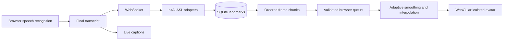

# Dynamic ASL avatar

The default animation view now renders an articulated WebGL character from
streamed skeletal coordinates. It no longer loads an MP4 or the static Asha
image. The separately labeled ISL video-library mode remains available.

## Scope and what sltAI supplies

The inspected local library is `sltai/sign-language-translator`, version 0.8.1
(local checkout `cca5f3a`). Its built-in sign provider and published sltAI motion
dataset are PSL. The user's requested target is ASL, excluding PSL. Therefore
the backend implements `ClassroomTextLanguage(TextLanguage)` and
`ASLVocabulary(SignLanguage)` against sltAI's extension interfaces, with an
external ASLLVD landmark dataset. Neither the PSL factory nor its datasets are
used. The upstream checkout is not modified.

This is **rule-based gloss composition plus ML-extracted motion**, not a trained
general-purpose speech-to-motion model. It supports 101 distinct signs, 117
English aliases and 135 Hindi aliases, explicit example sentences and bounded
bilingual patterns. All known-word sequences can be assembled dynamically;
unsupported words cause the entire request to fall back to captions. Arbitrary
ASL sentence grammar, facial grammar, discourse and word-sense disambiguation
are not solved. The interface labels the avatar as experimental.

## Components

| Boundary | Implementation |
| --- | --- |
| Speech input | Existing browser Web Speech hook; only final text is sent |
| Gloss translation | `backend/app/translation.py`, sltAI subclasses; `lexicon.json` owns aliases and examples |
| Landmark database | `backend/app/landmarks.py`, SQLite, ASL-only records with provenance |
| Import | `backend/scripts/prepare_asl.py`, verified ASLLVD archive, restricted data reader |
| Preparation | `backend/app/service.py`, resolves every gloss before streaming; missing data rejects the whole request |
| Transport | `backend/app/main.py`, FastAPI WebSocket `/ws/animation` |
| Client buffering | `src/lib/animationStream.js`, protocol validation and ordered chunk assembly |
| Session lifecycle | `src/hooks/useLiveAnimation.js`, bounded queues, timeouts and cancellation |
| Motion | `src/lib/motionSmoothing.js`, adaptive filtering, viewport normalization and transitions |
| Character | `src/lib/avatarRenderer.js`, native WebGL triangle geometry for head, torso, arms, palms and fingers |
| Playback clock | `AvatarCanvas.jsx`, animation-frame clock, interpolation, speed control and pause while hidden |



## Protocol version 1

Client sends:

```json
{"type":"translate","version":1,"request_id":"utterance-1","language":"en-IN","text":"I want water"}
```

The server first sends `ready` with ASL target, available vocabulary, examples
and readiness. Per request it sends `translation` with gloss order, then
`clip_start`, one or more `frames`, `clip_end` per sign, followed by `complete`.
Frame chunks contain `request_id`, `clip_index`, `offset` and at most 12 frames.
Each frame contains exactly 75 `[x,y,z,confidence]` points. The schema identifier
is `mediapipe-image-75-v1`. Errors have a request ID, code and user-facing message.

`{"type":"cancel","version":1}` invalidates outstanding work for that socket
and clears queued requests. The client also invalidates its local request IDs
immediately, so delayed frames cannot restart a stopped lecture. No transcript
is automatically replayed on reconnect. Separate sockets do not share queues.

Limits: 1200 transcript characters, 32 signs, 2400 frames per request, eight
pending requests per connection and 4800 buffered client frames. Preparation has
a 20-second timeout; the browser has a 30-second request timeout. Origin checks
apply explicitly to WebSockets as well as HTTP CORS. This is a local prototype;
internet deployment also needs authentication, global workload limits and TLS.

## Motion handling

Source geometry is normalized to an avatar viewport using a stable transform
for each entire clip. An adaptive low-pass filter removes small coordinate
jitter, with a lighter filter for fingers and a higher cutoff for rapid motion.
Forward/backward filtering reduces phase lag and preserves first/last poses.
Interpolation produces display-rate frames; 140 ms eased transitions prevent
hard jumps between signs. Missing hands remain marked missing rather than
inventing their shapes. Source handedness is preserved; the view is not mirrored.

Transitions are visual blending, not linguistically validated coarticulation.
The rig uses a neutral face and does not reproduce nonmanual grammar. See
`backend/data/README.md` for provisional frame-rate and source-data limitations.

## Configuration and extension

Vite proxies `/api` and `/ws` to `127.0.0.1:8000`. For a separately hosted frontend,
set `VITE_ANIMATION_WS_URL=wss://your-server/ws/animation` at build time, and list
the frontend origin in `SIGN_ALLOWED_ORIGINS` on the backend. HTTPS pages must
use WSS. `SIGN_DATABASE` selects an alternative SQLite path. No API key is needed.

To add vocabulary, select an actual ASLLVD label, add its gloss and explicit
English/Hindi aliases to `lexicon.json`, rerun the importer and run both test
suites. Avoid conflating alphabet labels and pronouns (`I` uses `ix_1p`), or
silently treating ambiguous Hindi words as a single meaning (`कल` is not an
alias for both yesterday and tomorrow).

A trained text-to-gloss provider can replace `GlossTranslator.translate` without
changing storage, streaming or rendering. Its output must still resolve through
the ASL catalogue and reject unavailable signs. Replacing the avatar artwork is
independent of translation; replacing the 75-point schema requires a protocol
version change and a tested retargeting adapter.

## Verification

```powershell
npm.cmd test
npm.cmd run build
.venv/Scripts/python.exe -m pytest backend/tests -q
```

Tests cover original ISL matching/playback, ASL aliases and bounded patterns,
unknown/negative statements, source-backed coordinates, atomic imports,
WebSocket ordering/cancellation/isolation, malformed frames, HTTPS/WSS,
interpolation, jitter reduction and geometry. `test_real_dataset.py` skips when
the local database has not been prepared.

Actual English and Hindi requests have also been checked over the Vite WebSocket
proxy against the prepared database. A geometry contact sheet was inspected.
Interactive browser verification was blocked by Computer Use's inability to
determine the current Chrome URL; microphone and browser WebGL behavior still
need a manual smoke check. No accuracy or latency target is claimed as measured.
